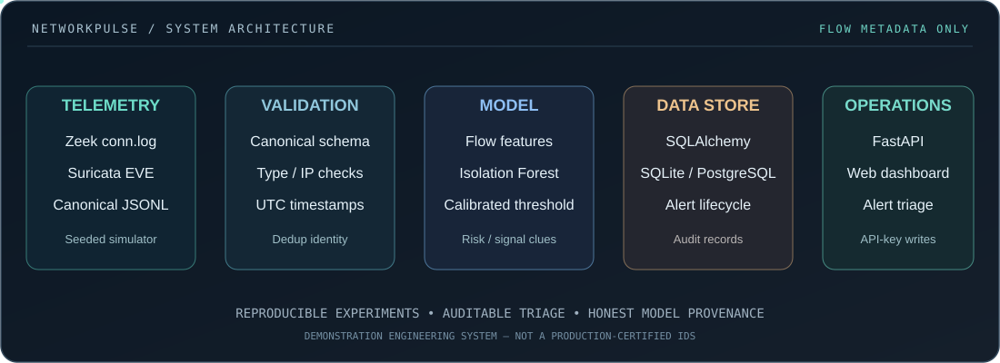

<div align="center">

# NetworkPulse AI

### Network observability · Machine-learning anomaly triage · Data engineering

**A reproducible, end-to-end engineering system for flow-metadata ingestion, unsupervised anomaly scoring, and auditable security investigations.**

[](https://github.com/Neloy4321/NetworkPulse-AI/actions/workflows/quality.yml)


[Quick start](#quick-start) · [Architecture](#system-architecture) · [Evaluation](#model-evaluation) · [API](#api--cli) · [Runbooks](docs/OPERATIONS.md) · [Model card](docs/MODEL_CARD.md)

</div>

---

> [!IMPORTANT]
> **Honest scope:** This is a working **engineering demonstration and research prototype**, not a verified production NDR/IDS product. The default model and displayed evaluation metrics use **deterministic synthetic flows**. No claims are made about real intrusion-detection accuracy or continuously running cloud deployments.

## The engineering problem

Network logs are produced in different shapes by different sensors. An investigator needs them normalized, scored consistently, stored without duplication, and connected to alerts that have an auditable review history. NetworkPulse AI implements that complete **vertical slice**, so data engineering, ML evaluation, API design, persistence, and operational visibility are demonstrable in a single repository.

<div align="center">

</div>

### What actually works

| Layer | Implementation | Evidence |
| :--- | :--- | :--- |
| **Telemetry ingestion** | Zeek `conn.log` JSON, Suricata EVE `flow` events, canonical JSONL | Tested adapters + example fixtures |
| **Input validation** | Typed fields, IP checks, UTC timestamps, counter bounds, batch size limits | Pydantic and API tests |
| **Feature pipeline** | Log-scaled flow duration, bytes, packets, rates, ratios, protocol and connection state | Versioned feature contract |
| **ML & evaluation** | Isolation Forest, benign-only training, **temporal 60/15/25 split**, calibration threshold, held-out evaluation | Reproducible `bootstrap`/`train`, [model card](docs/MODEL_CARD.md) |
| **Persistence** | SQLite/PostgreSQL; Alembic migrations; conflict-safe flow/alert writes | Migration, deduplication and concurrency tests |
| **Alert management** | Risk tiers, explanations as heuristic signals, open/investigating/resolved/false-positive states, audit trail | API + lifecycle tests |
| **Web application** | Responsive same-origin dashboard, charts, alert filters, operator triage | HTML/CSS/JS + FastAPI |
| **Replaying telemetry** | Rate-limited CLI JSONL HTTP replay, with API-key authorization | CLI and API tests |
| **Delivery** | Dockerfile, PostgreSQL Compose, typed CLI, GitHub Actions test workflow | Build/run configuration; see [limitations](docs/OPERATIONS.md) |

## Engineering upgrade status (v0.3 development)

The original dashboard and v0.2 database correctness features are preserved. The v0.3 work adds:

- **Official UNSW-NB15 CSV compatibility runner**, with Isolation Forest vs. LOF novelty vs. rule-based baseline, confusion matrices, PR-AUC/ROC-AUC/FPR, file provenance and cross-partition duplicate checks. **An official-dataset run and an independent chronological/site holdout are still pending**. See [benchmark methodology](docs/REAL_DATA_BENCHMARK.md).
- **Optional OIDC resource-server mode**: RS256 access tokens, HTTPS JWKS/issuer, audience and role checks, with Viewer/Analyst/Admin API permissions. Browser sign-in/PKCE is **not yet integrated**. Local demo mode is unchanged. [Threat model](docs/SECURITY_THREAT_MODEL.md).
- **Redis Streams collection and worker** with at-least-once replay, file checkpoints, pending-claim recovery, dead-letter behavior and bounded backlog. Opt-in [streaming runbook](docs/STREAMING_RUNBOOK.md).
- **Prometheus-format metrics and JSON request logging**, [operations limitations](docs/OBSERVABILITY.md).
- **Model drift and alert-budget reports**, windowed source-IP behavior aggregates, and alert filtering/sorting/pagination.

**Not complete:** The user's full twelve-part production-readiness checklist is tracked explicitly in [Release Status](docs/RELEASE_STATUS.md) and [GitHub issue #2](https://github.com/Neloy4321/NetworkPulse-AI/issues/2). These features must not be misrepresented as a production IDS.


## v0.4 upgrade — synthetic-first feature development

New engineering implementations use **existing seeded synthetic flows and supplied Zeek/Suricata JSONL examples**. No real intrusion-detection performance is claimed. The v0.4 schema revision is **`0003_soc_accountability`**; upgrade explicitly before starting the API:

```bash
networkpulse db backup --output data/backup-before-v04.sqlite  # if SQLite DB already exists
networkpulse db upgrade
networkpulse bootstrap
```

New API endpoints include `GET /api/v1/alerts/{id}/detail`, `POST /api/v1/alerts/{id}/notes`, `PATCH /api/v1/alerts/{id}/assignment`, `GET /api/v1/alerts/export.csv`, and `GET /api/v1/intelligence/correlations`. Status history now records the authenticated actor. All mutating requests have configurable single-process rate limiting and request-body caps; OIDC remains deployment-configured and must be tested against a real IdP before any internet-facing use.

Additional CLI workflows:

- **Model lifecycle:** `networkpulse model-registry --help` — register, checksum, gate, shadow, promote and rollback local trusted model artifacts.
- **Conservative retention:** `networkpulse archive --help` — dry-run first, export/checksum and archive only unalerted old flows.
- **Monitoring:** `docker compose -f compose.yaml -f compose.observability.yaml up --build` enables opt-in Prometheus/Grafana configuration (live deployment not yet verified).

References: [Model lifecycle](docs/MODEL_LIFECYCLE.md) · [Retention](docs/RETENTION_AND_ARCHIVAL.md) · [Observability stack](docs/OBSERVABILITY_STACK.md) · [Evidence matrix](docs/RELEASE_STATUS.md).


## v0.5 synthetic-first data readiness & deployment configuration

**No external real-data upload is required to run or test this release.** Existing seeded flows and example Zeek/Suricata JSONL records remain the executable defaults. Additional **offline benchmark adapters** are ready for later official-data ingestion; there are no manufactured real benchmark scores.

- `networkpulse benchmark-cic --train <operator-provided-train.csv> --test <disjoint-test.csv>`: CIC-IDS2017 CICFlowMeter CSV adapter, IF/LOF/rule comparison, file SHA-256, duplicate filtering. See [CIC compatibility](docs/CIC_DATASET_COMPATIBILITY.md).
- `networkpulse audit-data --data examples/generated-demo.jsonl`: data quality & lineage audit with flow IDs, duplicate counts and file checksum.
- `networkpulse enrich-offline --format zeek --data examples/zeek-conn.jsonl --assets assets.csv --indicators indicators.csv`: optional, local, operator-vetted asset/indicator context (no automatic blocking). See [Data quality and indicators](docs/DATA_QUALITY_AND_INDICATORS.md).
- Optional `MODEL_SHA256` environment setting rejects unrecognized model files at API/worker startup before deserialization.
- Multi-stage Python Dockerfile, manual TLS/OIDC staging example and scheduled dependency vulnerability auditing workflow. **None of these configurations demonstrates a completed public staging deployment, real IdP login or passed external security assessment.** See [TLS staging](docs/TLS_STAGING.md).


## Verified external offline benchmarks (October 2026)

All three user-supplied archives (CIC-IDS2017, UNSW-NB15 raw and TON-IoT-compatible)
were evaluated in [GitHub Actions](https://github.com/Neloy4321/NetworkPulse-AI/actions/runs/38461006624).
See [full real-data results](docs/REAL_DATA_RESULTS.md).
**Real native-model evaluation:** Our actual
[NetworkPulse Detector architecture](docs/REAL_DATA_RESULTS.md#native-networkpulse-detector-evaluation--real-unsw-capture)
has now also been tested on an independent later UNSW-NB15 capture, not
just with synthetic seeded flows. False positives remain a significant
limitation; this is not a deployed production model validation.
 The published figures are
**offline, separate-capture baseline measurements**, not accuracy of the deployed
Zeek/Suricata model. Source-data files remain outside Git.

## Dashboard

The custom browser console features flow counts, risk summaries, five-minute UTC traffic windows, protocol distribution, a reviewable alert queue, and transparent model provenance. The app uses **no remote frontend CDNs** and works on localhost.

- **Overview:** rolling summary and detector readiness.
- **Traffic:** volume and anomaly trends, network protocol mix.
- **Investigations:** severity, source/destination, reasons, status transitions.
- **Model:** data provenance, split sizes, calibration threshold, held-out F1.

**No live hosted dashboard is claimed.** Start it locally to use the working interface.

## System architecture


downloaded Zeek / Suricata JSONL or seeded synthetic generator
: Incoming data is **flow metadata only**; no packet capture or payload interception is performed.

Normalize and validate
: JSONL adapters convert Zeek or Suricata records to a canonical schema; reject malformed flows and skip unrelated EVE event types.

Feature computation and scoring
: Versioned deterministic feature extraction → fitted DictVectorizer → Isolation Forest anomaly score → benign-calibration threshold and relative 0–100 triage risk.

Store, investigate, audit
: Deduplicated flow events → anomaly-created alert → authenticated review decisions → append-only status audit entries.

More detail in the [architecture specification](docs/ARCHITECTURE.md) and [data dictionary](docs/DATA_CONTRACT.md).

## Quick start

**Requirements:** Python 3.11–3.13 and a local terminal. No AWS account, API token, external dataset, model download, PostgreSQL, or packet-capture privileges are needed for the default SQLite demo.

### 1. Install

```bash
git clone https://github.com/Neloy4321/NetworkPulse-AI.git
cd NetworkPulse-AI
python -m venv .venv
# Linux/macOS:
source .venv/bin/activate
# Windows PowerShell (instead of above): .venv\Scripts\Activate.ps1
python -m pip install -e ".[dev]"
```

### 2. Create a local API key

```bash
# Linux/macOS example — use your own random secret:
export NETWORKPULSE_API_KEY="$(python -c 'import secrets; print(secrets.token_urlsafe(32))')"
```

Windows PowerShell equivalent:

```powershell
$env:NETWORKPULSE_API_KEY = python -c "import secrets; print(secrets.token_urlsafe(32))"
```

### 3. Initialize / migrate the database

Before your first bootstrap, or **after updating from the 0.1 release**, run:

```bash
networkpulse db status
networkpulse db upgrade
```

Existing SQLite databases are backed up automatically before a required migration. For a separate manual backup, use `networkpulse db backup --output data/pre-upgrade.sqlite`. See the [database migration & recovery runbook](docs/DATABASE_MIGRATIONS.md). If you have already bootstrapped a demo with an older ZIP, **do not delete your `data/` folder**.

### 4. Train and load a reproducible demo

```bash
networkpulse bootstrap
```

This command **trains a model from synthetic data**, writes it to `data/model.joblib`, creates a local SQLite database at `data/networkpulse.db`, and inserts the **chronological holdout** events for dashboard demonstration. Re-running is idempotent for the same seed/dataset. The model artifact and database are ignored by Git.

### 5. Run the API + dashboard

```bash
uvicorn networkpulse.api:create_app --factory --host 127.0.0.1 --port 8000
```

Open **http://127.0.0.1:8000** for the dashboard or **http://127.0.0.1:8000/docs** for Swagger/OpenAPI documentation.

> **Protect your API key.** Ingestion and alert status mutation endpoints require the `X-API-Key` header. Read-only dashboards and model metadata are available to users who can reach the service, so the default bind is localhost.

### 6. Ingest real-format sample metadata

With the previous setup still available:

```bash
networkpulse ingest-file --format zeek --path examples/zeek-conn.jsonl
networkpulse ingest-file --format suricata --path examples/suricata-eve.jsonl
```

Both example files are included in this repo; the Suricata adapter skips non-flow EVE records. Your own Zeek/Suricata **JSON-format** log files can be supplied with the same commands after checking [schema compatibility](docs/DATA_CONTRACT.md).

### Advanced CLI (opt-in)

```bash
# Download UNSW-NB15 train/test partition CSVs yourself from the official academic source.
networkpulse benchmark-unsw --train data/external/UNSW_NB15_training-set.csv --test data/external/UNSW_NB15_testing-set.csv --output reports/unsw.json

# Drift report uses a model fitted by this version (old v0.1 artifacts lack drift baseline).
networkpulse drift-report --data examples/generated-demo.jsonl --model data/model.joblib --output reports/drift.json

# Requires Redis 7 running, a separate worker and authorized Zeek/Suricata logs.
networkpulse worker --consumer workstation-1
networkpulse collect --format zeek --path /path/to/conn.log --checkpoint data/collector-offset.json
```

Redis Python dependency: `pip install -e '.[streaming]'`. For additional safeguards and operating limits, see the [streaming runbook](docs/STREAMING_RUNBOOK.md).

## Reproducible ML workflow

Generate, fit, evaluate and save a model from a known seed:

```bash
networkpulse generate-demo --count 1300 --seed 42 --output examples/generated-demo.jsonl
networkpulse train --data examples/generated-demo.jsonl --model data/retrained-model.joblib --seed 42
```

The training pipeline sorts by UTC timestamp and splits: **60% for benign-only fitting, 15% for benign-only calibration, and 25% for an untouched chronological evaluation holdout**. Test labels are never used in model training or threshold selection. Unknown categories are handled by the fitted DictVectorizer.

### Model evaluation

Local smoke-tested command: `networkpulse bootstrap --count 1300 --seed 42`

| Metric | Observed synthetic holdout result |
| :--- | ---: |
| Training events | 780 |
| Calibration events | 195 |
| Chronological holdout events | 325 |
| Synthetic outliers in holdout | 50 |
| Flagged holdout events | 66 |
| Precision | 0.7576 |
| Recall | 1.0000 |
| F1 | **0.8621** |
| ROC AUC | 1.0000 |

These numbers are **solely from easy-to-separate seeded synthetic examples** and must **not** be represented as real-world threat detection performance. For realistic evaluation, use authorized labeled flow datasets, separate sites and time periods, and compare against supervised/rule-based baselines. See [MODEL_CARD.md](docs/MODEL_CARD.md).

## API & CLI

| Endpoint | Method | Purpose | Authentication |
| :--- | :--- | :--- | :--- |
| `/health/live` | GET | Process health | No |
| `/health/ready` | GET | DB + detector readiness | No |
| `/api/v1/model` | GET | Model provenance and evaluation metadata | Local: No / OIDC: Viewer+ |
| `/api/v1/summary` | GET | Ingestion/alert/protocol counters | No |
| `/api/v1/trends` | GET | 5-minute UTC windows | No |
| `/api/v1/events` | GET | Filterable recent flows | No |
| `/api/v1/alerts` | GET | Investigation queue | No |
| `/api/v1/alerts/{id}/history` | GET | Alert audit history | No |
| `/api/v1/ingest` | POST | Up to 250 validated flow objects | **X-API-Key** |
| `/api/v1/alerts/{id}` | PATCH | New state and required audit note | **X-API-Key** |

**RBAC:** In OIDC mode, read APIs require Viewer+, ingestion/triage require Analyst+, and Prometheus `/metrics` requires Admin. The default localhost demo still uses an API key for writes and leaves reads unprotected; never expose it directly on the internet.

**Authenticated traffic replay:**

```bash
networkpulse replay --format zeek --path examples/zeek-conn.jsonl \
  --url http://127.0.0.1:8000 --batch-size 2 --delay 0.5
```

This command reads `NETWORKPULSE_API_KEY` from the environment and sends batches to the API. See the [API cookbook](docs/API_EXAMPLES.md) for JSON and curl examples.

## Docker & PostgreSQL

The included local-development Compose stack runs the **same Python API/dashboard** with PostgreSQL persistence and a writable model volume. This is a localhost development deployment, **not** hardened internet hosting.

```bash
cp .env.example .env
# Edit .env, set a strong NETWORKPULSE_API_KEY and POSTGRES_PASSWORD.
docker compose up --build
```

Compose runs a schema migration before bootstrapping the demo; do not use this startup mechanism as a multi-replica production migration strategy. Do not commit `.env`. The Compose deployment is bound to `127.0.0.1:8000` by default. See [Operations](docs/OPERATIONS.md) for security, upgrades, migrations and known limitations.

## Quality & verification

- Automated **pytest** checks cover parsers, schema validation, time-ordered training, model serialization, authenticated ingest, idempotency, alert audit and CLI commands.
- `ruff check networkpulse tests` and `python -m compileall -q networkpulse` are configured in GitHub Actions for **Python 3.11 and 3.12**.
- The original 0.1 release recorded **23 passing tests** and **92% local coverage**; the DB integrity upgrade adds regression, concurrency, schema migration, and backup/restore tests. Review current **GitHub Actions results** for the latest verified count/coverage.
- Browser UI is included and locally served; the CLI/API/model tests do **not** constitute a full visual or browser E2E test.

## Repository layout

```text
NetworkPulse-AI/
├── networkpulse/
│   ├── adapters.py       # Zeek / Suricata / canonical event adapters
│   ├── schemas.py        # Input validation and idempotency contract
│   ├── features.py       # Leakage-aware feature contract
│   ├── simulator.py      # Deterministic labeled demo flows
│   ├── detector.py       # Isolation Forest, calibration, evaluation
│   ├── storage.py        # SQLAlchemy events, alerts, audit
│   ├── service.py        # Scoring + idempotent ingestion
│   ├── api.py            # API, auth and dashboard endpoints
│   ├── cli.py            # bootstrap / train / ingest / replay
│   └── static/           # Responsive HTML/CSS/JavaScript dashboard
├── tests/                # Pytest suite
├── examples/             # Small illustrative Zeek / Suricata logs
├── alembic/              # Versioned schema migrations
├── alembic.ini
├── docs/                 # Architecture, model card, DB migration & operations
├── .github/workflows/    # Python quality gates
├── Dockerfile
├── compose.yaml
└── pyproject.toml
```

## Limitations & future directions

Implemented: **batch/file ingestion, bounded atomic SQL upserts, Alembic migrations and throttled replay**, not continuous packet sniffing or Kafka streaming; **Isolation Forest**, not a production-certified threat engine; **manual triage**, not automatic incident blocking; **API-key protection**, not enterprise RBAC/OIDC.

Planned, **not implemented**: Kafka/Redpanda + ClickHouse, Zeek/Suricata continuous collectors, model drift monitoring and rolling retraining, formal RBAC and audit export, network topology enrichment, Helm/Kubernetes and multi-sensor benchmarks. See [roadmap](docs/ROADMAP.md).

## Project owner

**Neloy Pramanik Supto** · Computer Science & Engineering · Dhaka, Bangladesh  
[GitHub](https://github.com/Neloy4321) · [Portfolio](https://www.supto.me) · [LinkedIn](https://linkedin.com/in/neloy-pramanik-supto-b52677236) · [Email](mailto:neloybbs@gmail.com)

**License:** MIT. **Security:** [Responsible use and reporting](SECURITY.md).

## Reliability and explainability improvements (October 2026)

- Benign-only calibration diagnostics and internal chronological holdout
  confusion matrix, observed FPR, one-sided Wilson uncertainty bound and
  label-aware protocol/sensor/port-class error slices.
- Optional bounded Isolation Forest **score-sensitivity** explanation:
  `networkpulse explain-model --model data/model.joblib --data data/authorized-flows.jsonl`.
  This is a marginal perturbation diagnostic **not SHAP nor causal attribution**.
- Drift PSI reports require meaningful windows (30+ events) and can compute
  labeled retrospective FPR when trusted ground truth exists.
- Model registration optionally enforces a **held-out FPR confidence upper
  bound**, while `model-registry promote --production --evidence ...`
  requires declared independent-site/sensor validation and human approval.
  JSON receipts do **not** cryptographically prove these declarations.
- The project remains **not independently production validated**; these
  protections do not change the measured real held-out false-positive rate.
  See [model lifecycle](docs/MODEL_LIFECYCLE.md) and
  [model card](docs/MODEL_CARD.md).


Real-data calibration policy experiment: [ML reliability milestone](docs/ML_RELIABILITY_MILESTONE.md).
This is a held-out cyber-range sensitivity study, not a production-safe threshold or a promoted model.


## October 2026 API security hardening

Implemented bounded fail-closed rate buckets, response security headers, spreadsheet-safe SOC CSV exports, OIDC JWT bounds, placeholder-key rejection, and CI dependency/static security scanning. See [Security Milestone](docs/SECURITY_HARDENING_MILESTONE.md) and [Threat Model](docs/SECURITY_THREAT_MODEL.md). **Interactive browser OIDC/PKCE, production TLS and independent penetration testing remain open.**
