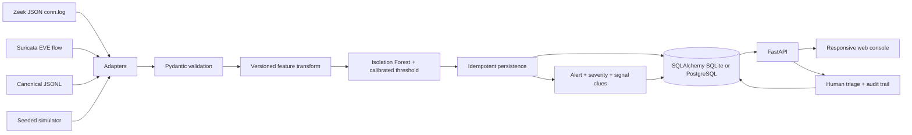
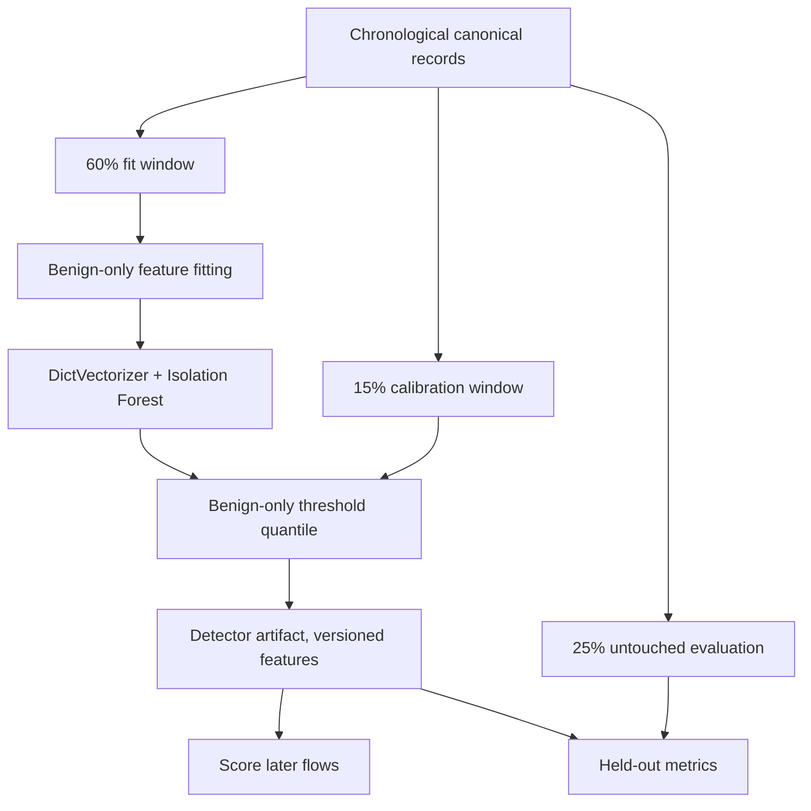
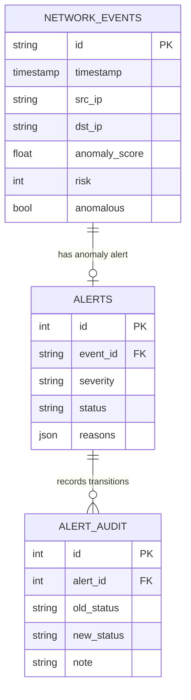

# Architecture & Engineering Decisions

## High-level system

## Design boundary: flow metadata, not packets

No packet payloads, credentials, PCAP decoding, capture daemon, or packet injection. Input consists of summarized connections: IPs, ports, direction-dependent counters, duration, protocol and state. The project accepts logs from your own network or authorized datasets only.

## Ingestion and idempotency

1. Each connector transforms an external JSON object into a strict `FlowEvent` schema.
2. Timestamp is normalized to UTC; IPs and unsigned counters are validated.
3. `key()` hashes the canonical serialized event, excluding only evaluation labels.
4. Service checks existing keys and inserts each unseen event once; alert rows have a unique event FK.
5. Replaying the same file does not create duplicate flows or duplicate alerts.

**Current limitation:** The `SELECT`-then-`INSERT` idempotency path protects serial/sequential replay and tested duplicates. Concurrent writers can still race on the same key and encounter a unique-constraint exception; production scaling should use PostgreSQL `ON CONFLICT DO NOTHING` / idempotent upserts.

## Model lifecycle

- **Anomaly score:** negative Isolation Forest decision function (larger means more unusual).
- **Threshold:** 97th percentile of independent benign calibration scores (configurable at training).
- **Relative risk:** a clipped linear mapping around this threshold to 0–100. Not a posterior probability and not independently calibrated to incident severity.
- **Explanation reasons:** interpretable rule-based *signals* attached to a flow (e.g., no response packets). They are **not SHAP attributions** or causal explanations of the Isolation Forest decision.
- **Artifact loading:** joblib uses pickle; only locally generated/trusted artifacts may be loaded.

## API and security

The browser and API share an origin; no permissive CORS rule is added. Mutating operations require `X-API-Key` and compare in constant time. The browser prompts for the key during triage and never writes it to local storage. Read-only endpoints are unauthenticated for local exploration. In production, isolate the app behind a trusted reverse proxy, TLS and stronger identity control.

## Persistence schema

## Deployment approaches

- **Fastest run:** Python + SQLite + local file artifact.
- **Compose:** Python API service + PostgreSQL 16 + model/data volume.
- **Cloud readiness:** This repo is a demonstrable baseline; backups, schema migrations, SSO, hosted telemetry integration, rate limiting at a gateway, and deployment verification remain to be implemented.
